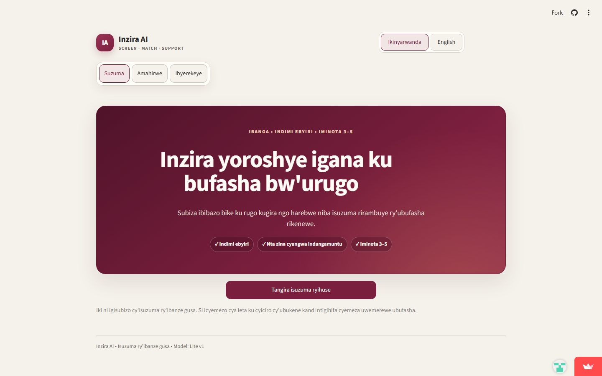
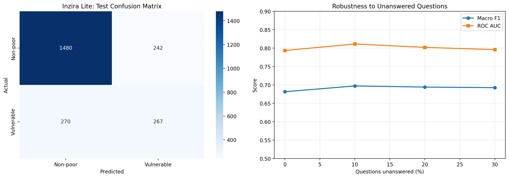

# Inzira AI

**NISR 2026 Big Data Hackathon — Track 2: Financial Inclusion & Poverty Reduction**

[Open the live application](https://inzira-ai-rwanda.onrender.com/) · [NISR 2026 competition](https://www.statistics.gov.rw/about/hackathon/2026-hackathon-competition)

Inzira AI is a privacy-conscious household economic-vulnerability screening and opportunity-navigation platform for Rwanda. It converts 12 accessible question groups into an initial screening estimate, explains the result in plain language, proposes practical support pathways, and matches people with verified employment, training, enterprise, agriculture and social-protection opportunities.

The application is **decision support only**. It does not issue an official poverty classification and must never approve, deny or withdraw benefits, credit, insurance, employment or public assistance without human review.

## Product preview



## Team

**Registered team:** Inzira Tech

- Akinloye Emmanuel Oluwajomiloju
- Iriza Kate Julius Lorna

## The problem

Detailed household surveys provide valuable evidence, but they contain far more questions than a citizen or field officer can reasonably complete during an initial interaction. At the same time, a risk score alone does not solve a household's problem: people need understandable next steps and safe routes to legitimate services.

Inzira AI addresses this gap with a short first-stage screening flow and an opportunity-navigation layer. It is designed for households, field officers and community organisations that need to identify when a complete assessment may be useful and what verified support route to explore next.

## What the solution does

1. **Screens accessibly:** 12 user-facing question groups generate 19 raw model predictors.
2. **Handles incomplete responses:** users can leave questions unanswered; completeness is shown with the result.
3. **Estimates vulnerability:** a compact XGBoost model estimates whether a complete economic-vulnerability assessment should be considered.
4. **Explains the result safely:** the interface avoids presenting the prediction as eligibility, causation or an official classification.
5. **Builds an action plan:** household answers generate practical, human-reviewable support suggestions.
6. **Matches opportunities:** a separate three-step matcher returns the three most relevant verified service pathways. Fit means relevance, not acceptance probability.
7. **Supports follow-up:** a protected administrator application can record anonymous referrals, follow-up dates, barriers and provider-reported outcomes.

## Public workflow

```text
12-question household check
            |
            v
 Completeness and safety checks
            |
            v
 Compact XGBoost screening estimate
            |
            +--> Plain-language result and safeguards
            +--> Household action plan
            +--> Verified opportunity matching
```

The public application contains three focused areas:

- **Check:** initial household screening and practical next steps.
- **Opportunities:** employment, internship, training, enterprise and support matching.
- **About:** evidence, limitations and responsible-use information.

## Data

The modelling pipeline uses the **National Institute of Statistics of Rwanda Integrated Household Living Conditions Survey 7 (EICV7), 2023–2024, cross-sectional sample**.

The household, person and poverty files were joined at household level. Person-level information was aggregated before modelling to avoid treating household members as independent households. The binary Lite target groups extreme- and moderate-poverty households as the vulnerable class and compares them with non-poor households.

The raw EICV7 microdata is intentionally excluded from this repository. The deployed bundle contains no names, telephone numbers, national identification numbers or household-level test predictions.

Official sources:

- [NISR EICV7 survey page](https://statistics.gov.rw/data-sources/surveys/EICV/integrated-household-living-conditions-survey-7-eicv-7)
- [NISR EICV7 microdata catalogue](https://www.microdatabk.statistics.gov.rw/catalog/119)
- [EICV7 Main Indicators Report 2023/24](https://www.statistics.gov.rw/statistical-publications/poverty-and-social-protection/eicv7-main-indicators-report-202324)

## Methodology

The development pipeline:

1. Audited the EICV7 household, person and poverty tables.
2. Created household-level demographic, employment, agriculture, insurance, asset and access features.
3. Split households into fixed training, validation and locked test partitions.
4. Compared classical models, gradient-boosting models, a neural network and ensemble approaches.
5. Developed a richer hierarchical model for research and a compact Lite model for realistic public use.
6. Trained the Lite model with simulated missing answers so that optional questions remain operational.
7. Selected the model and threshold using validation data only.
8. Evaluated once on the locked test set; no subsequent tuning used test results.

Lite partition sizes:

| Partition | Households |
|---|---:|
| Training | 10,537 |
| Validation | 2,258 |
| Locked test | 2,259 |

### Deployed model

- Algorithm: Compact XGBoost
- Target: vulnerable versus non-poor
- User-facing question groups: 12
- Raw model predictors: 19
- Processed predictors: 49
- Frozen decision threshold: `0.49`
- Interface languages: Kinyarwanda and English

The complete predictor mapping, model configuration, evaluation outputs and integrity hashes are included in [`artifacts/inzira_lite_v1_20261024_235457`](artifacts/inzira_lite_v1_20261024_235457).

## Locked-test evidence

| Metric | Result |
|---|---:|
| Accuracy | 0.7734 |
| Balanced accuracy | 0.6783 |
| Macro F1 | 0.6815 |
| Vulnerable precision | 0.5246 |
| Vulnerable recall | 0.4972 |
| Vulnerable F1 | 0.5105 |
| ROC AUC | 0.7933 |
| Average precision | 0.5466 |
| Brier score | 0.1502 |

Bootstrap 95% confidence intervals:

- Macro F1: 0.6607–0.7041
- ROC AUC: 0.7730–0.8134



### Missing-answer robustness

| Questions unanswered | Macro F1 | ROC AUC |
|---:|---:|---:|
| 0% | 0.6815 | 0.7933 |
| 10% | 0.6972 | 0.8111 |
| 20% | 0.6941 | 0.8018 |
| 30% | 0.6926 | 0.7958 |

These simulations show that the preprocessing pipeline remains operational when some answers are missing. They do not imply that missing information improves prediction.

## Fairness and responsible use

The final subgroup audit found meaningful differences, especially by household-size band. Vulnerable recall for households with one to three members was low, so the interface recommends a complete assessment for small households even when the Lite result is below the decision threshold.

Required safeguards implemented in the application include:

- never displaying “not vulnerable” as a decision;
- never denying support from the screening result;
- always providing a route to complete human assessment;
- displaying response completeness;
- showing the small-household limitation when relevant;
- excluding personal identifiers from referral records;
- separating opportunity relevance from eligibility or acceptance decisions; and
- reserving all material decisions for authorised people and service providers.

The Kinyarwanda content remains a structured draft pending native-speaker review before field deployment.

## Opportunity matching and impact pathway

The matcher uses a reviewed catalogue of official or provider-operated service pathways. It compares a user's goal, profile, skills, preferred support and access needs with catalogue metadata. It does not use the poverty probability to rank jobs or training opportunities.

The platform does not submit applications or CVs. Users continue to official provider websites, where the provider controls current availability, eligibility and acceptance. Administrators do not approve jobs or programme benefits; they only record anonymous referrals and provider-reported progress.

## Administrator role and permissions

The hackathon prototype currently has one protected **Administrator** role. Firebase Email/Password verifies the identity, and an email allowlist provides a second authorisation check. Every allowlisted administrator currently has the same permissions.

| Administrator can | Administrator cannot |
|---|---|
| Create anonymous referral records after consent | Approve employment, benefits, credit, insurance or programme eligibility |
| Update referral status, provider-reported outcome and barrier | Change the trained model, predictor definitions or frozen threshold |
| Set and review follow-up dates | Read public users' unsaved screening answers |
| View aggregate referral metrics and overdue follow-ups | Edit the opportunity catalogue from the dashboard |
| Export or import the referral CSV schema | Create Firebase users or alter the admin allowlist inside the app |
| Review the read-only opportunity directory and administrator audit history | Replace the decision of an official service provider |

Referral changes are written to Neon PostgreSQL, persist after application restarts, and are visible to other authorised administrators after refresh. The audit table records the administrator email, action, case ID and timestamp. The prototype intentionally stores anonymous operational fields rather than names, national IDs, telephone numbers or free-text personal notes.

Production deployment should separate super-administrator, case-officer and read-only reviewer permissions instead of giving every allowlisted administrator the same access.

## Technical architecture

```text
Public Streamlit app
  ├── XGBoost Lite model + scikit-learn preprocessor
  ├── bilingual screening and action-plan rules
  └── reviewed opportunity catalogue

Protected admin Streamlit app
  ├── Firebase Email/Password authentication
  ├── administrator email allowlist
  └── Neon PostgreSQL
       ├── anonymous referrals
       └── administrator audit events
```

The public screening responses remain in the visitor's Streamlit session and are not automatically written to Neon.

## Repository structure

```text
app.py                              Public Streamlit application
admin_app.py                        Separate protected administrator application
Inzira_AI_NISR_2026.ipynb           Documented modelling and evaluation notebook
src/inzira/                         Application, inference and governance modules
data/opportunities.json             Reviewed opportunity pathways
artifacts/inzira_lite_v1_*/         Model, preprocessor, evidence and model card
tests/                              Unit tests
scripts/                            Inference, UI and deployment smoke tests
requirements.txt                    Reproducible deployment dependencies
```

## Run locally

Use Python 3.12 on Linux, WSL or Streamlit Community Cloud.

```bash
python3.12 -m venv .venv
source .venv/bin/activate
pip install -r requirements.txt
streamlit run app.py
```

The public application does not require secrets. To run the separate administrator application, copy `.env.example` to `.env` and privately provide the Neon, Firebase and administrator allowlist configuration. Never commit `.env`, `.streamlit/secrets.toml`, administrator passwords or database connection strings.

## Deploy on Render

The repository includes [`render.yaml`](render.yaml) for a free Render web service. It deploys the existing public Streamlit application, uses Python 3.12.8, binds Streamlit to Render's assigned port and exposes Streamlit's health endpoint.

1. In Render, choose **New > Blueprint** and connect this GitHub repository.
2. Review the `inzira-ai-rwanda` service generated from `render.yaml`.
3. Confirm the free instance before applying the Blueprint.
4. After deployment, verify the application and `/_stcore/health` endpoint.

Free Render web services spin down after 15 minutes without inbound traffic. For the competition demonstration, an external uptime monitor can request `https://inzira-ai-rwanda.onrender.com/_stcore/health` every five minutes. This is a lightweight health check, not a production uptime guarantee. Render currently provides 750 free instance-hours per workspace each month, so do not keep a second free service continuously awake from the same workspace. The public application requires no environment variables. Deploy `admin_app.py` as a separate protected service only when its Neon and Firebase values can be entered directly in the Render dashboard.

Netlify cannot directly execute this long-running Python Streamlit/WebSocket server. Hosting a static Netlify page in front of Render would add another layer without preventing backend sleep, so Render is the production host for this version. A future Netlify deployment would require rebuilding the public interface as a static JavaScript frontend and exposing inference through a separate API.

## Verification

```bash
pip install pytest
python -m pytest -q
python scripts/smoke_inference.py
python scripts/smoke_ui.py
python scripts/smoke_opportunity_matcher.py
python scripts/smoke_admin_login.py
```

The repository currently passes 18 automated tests covering feature preparation, model inference, recommendations, opportunity matching, referral tracking and authentication helpers.

## AI-assistance disclosure

OpenAI ChatGPT and Codex were used as development assistants for code review, debugging, interface iteration, test support and documentation drafting. The Inzira Tech team selected the problem, made the product and modelling decisions, executed and reviewed the analysis, validated the outputs, and accepts full responsibility for the submitted work. No generative-AI output is treated as an authoritative eligibility or welfare decision.

## Originality and attribution declaration

Inzira Tech declares that Inzira AI is the team's original submission for the NISR 2026 Big Data Hackathon, has not been submitted to another competition or entity, and acknowledges the datasets, software libraries, public-service providers and reference sources used. The team accepts the intellectual-property conditions stated in the official NISR 2026 competition rules.

## Limitations

- This is a screening prototype, not an official poverty-measurement instrument.
- Performance may change outside the EICV7 population and survey period.
- Opportunity listings and deadlines can change and must be confirmed with providers.
- Model predictions do not establish causation or programme impact.
- Kinyarwanda wording requires native-speaker approval before field use.
- Production use would require institutional governance, retention policies, security review, monitoring and an appeals process.

## Competition links

- [Live public application](https://inzira-ai-rwanda.onrender.com/)
- [Public GitHub repository](https://github.com/Akinloye3264/Inzira_AI)
- [NISR 2026 Big Data Hackathon](https://www.statistics.gov.rw/about/hackathon/2026-hackathon-competition)
